# Original / candidate visual comparison

Original reference: `6e57eabfb5b51af4475b90686fa580b5ce57e9b0`. Candidate screenshots below are generated by the native QA comparison harness from the installed application outside the checkout. Same fixed renderer viewport and default theme; the virtual Mac display constrains native window bounds, so viewport emulation is explicitly used for these comparison captures; renderer API routes are blocked in the comparison harness to keep the observation offline and comparable. Populated real News evidence is separate in NEWS.md.

Original CSS tokens/base/components/shell/tools/views, graphic assets and animation definitions remain unchanged. Acceptance also uses actual rendered screens; unchanged CSS alone is insufficient. The original News block was inside Generator, so there is no original standalone News screen. The candidate follows issue #4's explicit separate News navigation requirement.

## Generator

| Original 1280×900 | Candidate 1280×900 |
|---|---|
| 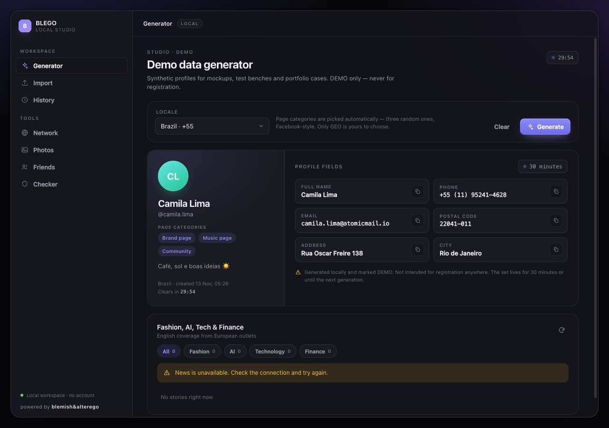 | 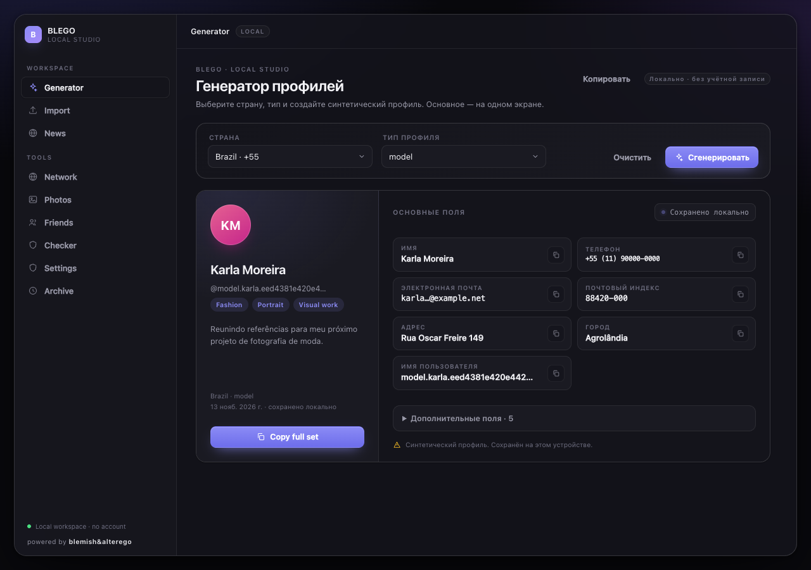 |

[Narrow original](native/ux-original-generator-980.png) · [Narrow candidate](native/ux-candidate-generator-980.png)

## Network

| Original 1280×900 | Candidate 1280×900 |
|---|---|
| 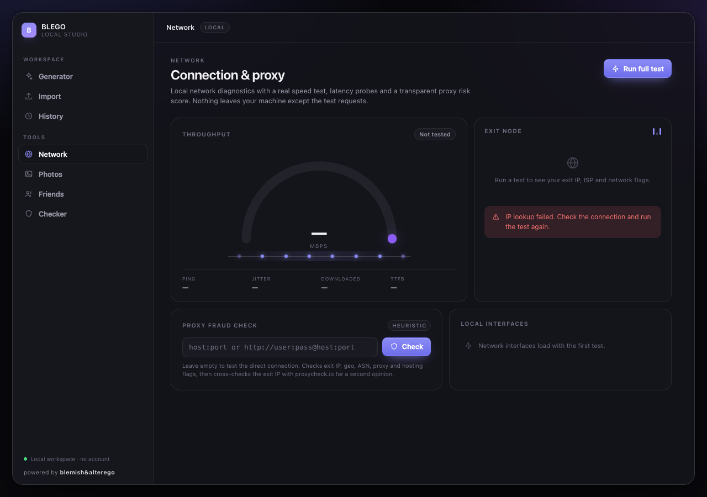 | 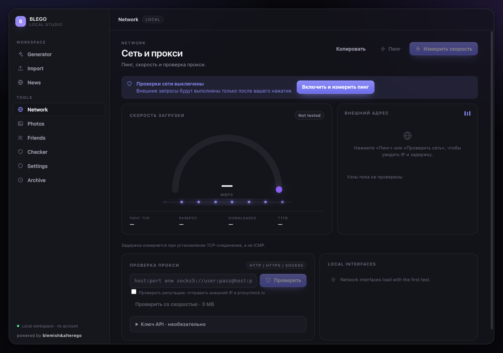 |

[Narrow original](native/ux-original-network-980.png) · [Narrow candidate](native/ux-candidate-network-980.png)

## Facebook

| Original 1280×900 | Candidate 1280×900 |
|---|---|
| 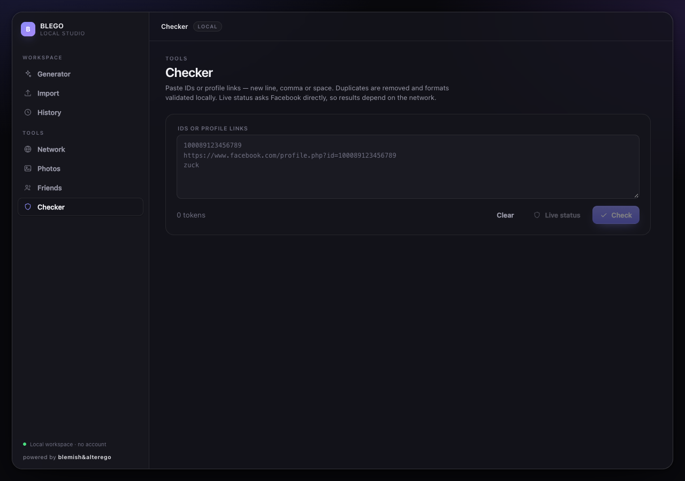 | 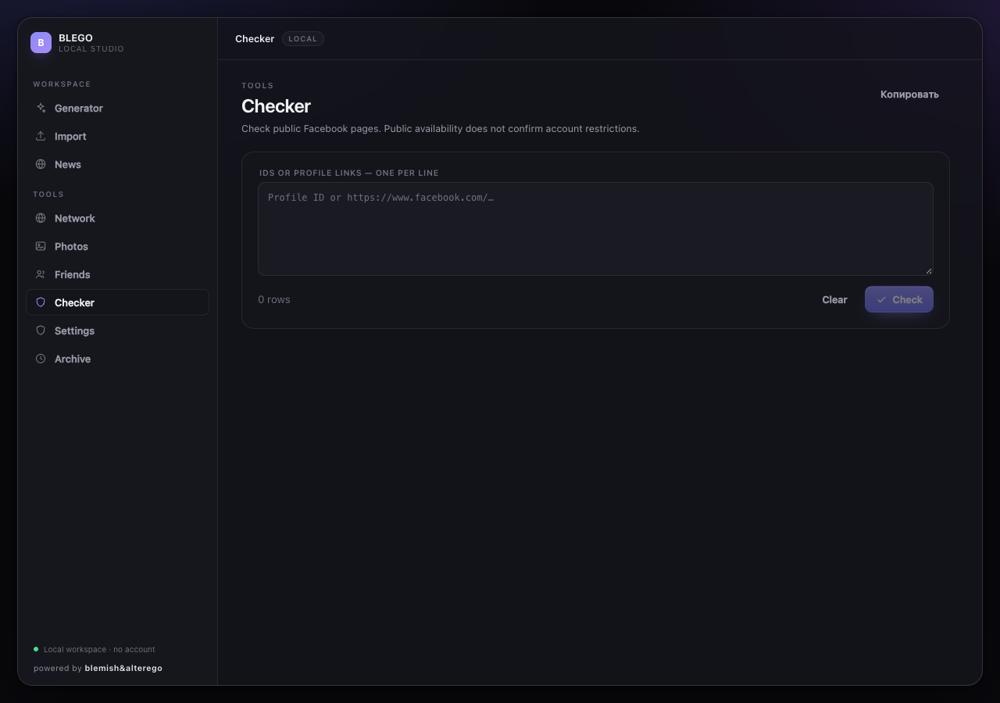 |

[Narrow original](native/ux-original-checker-980.png) · [Narrow candidate](native/ux-candidate-checker-980.png)

## Photos

| Original 1280×900 | Candidate 1280×900 |
|---|---|
| 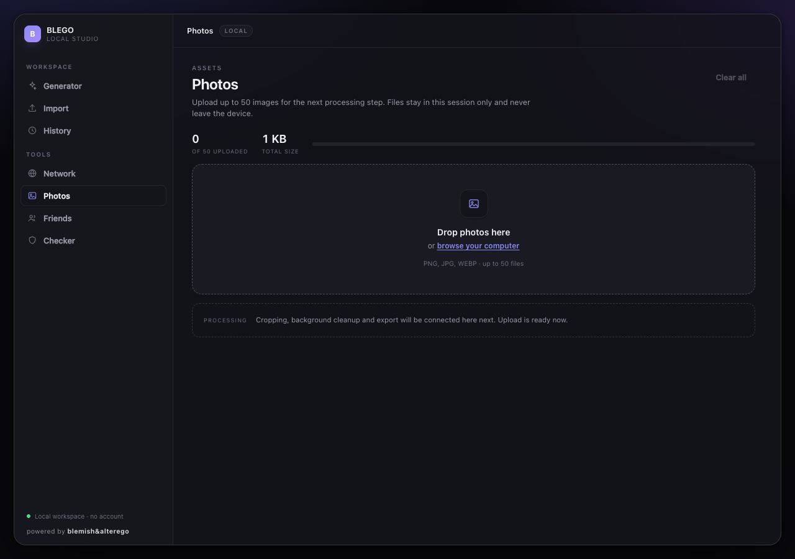 | 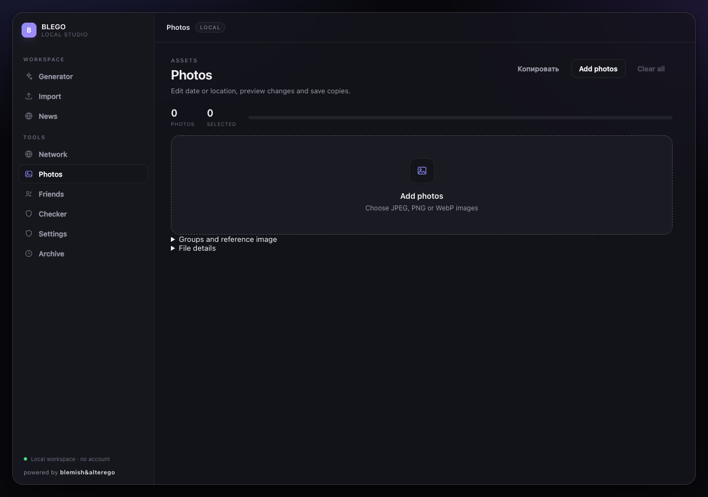 |

[Narrow original](native/ux-original-photos-980.png) · [Narrow candidate](native/ux-candidate-photos-980.png)

## Archive

| Original 1280×900 | Candidate 1280×900 |
|---|---|
| 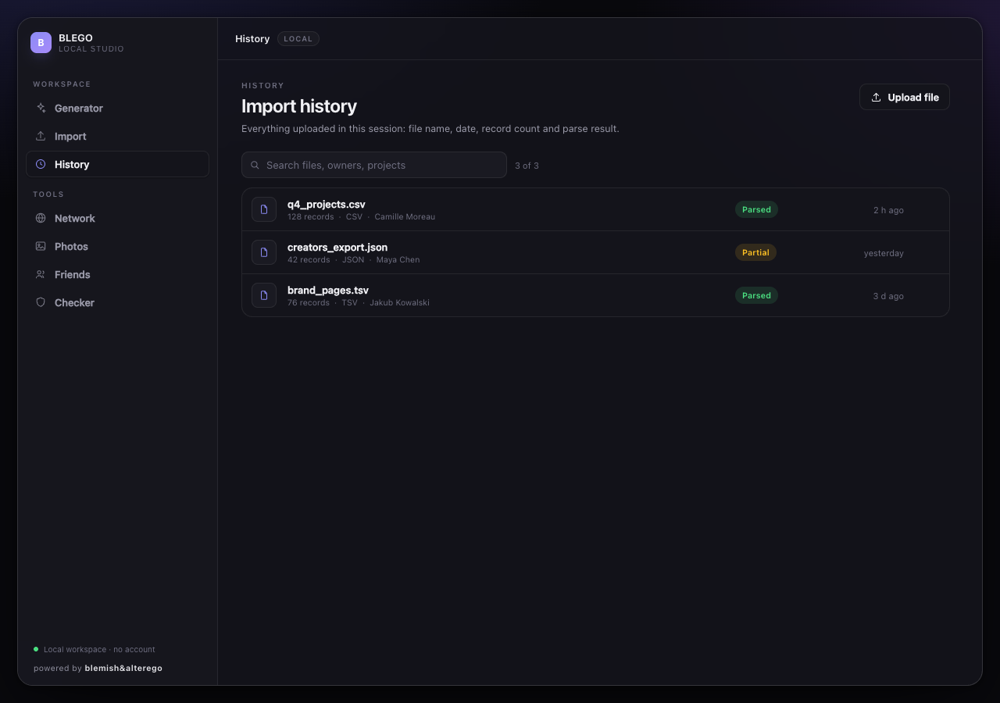 | 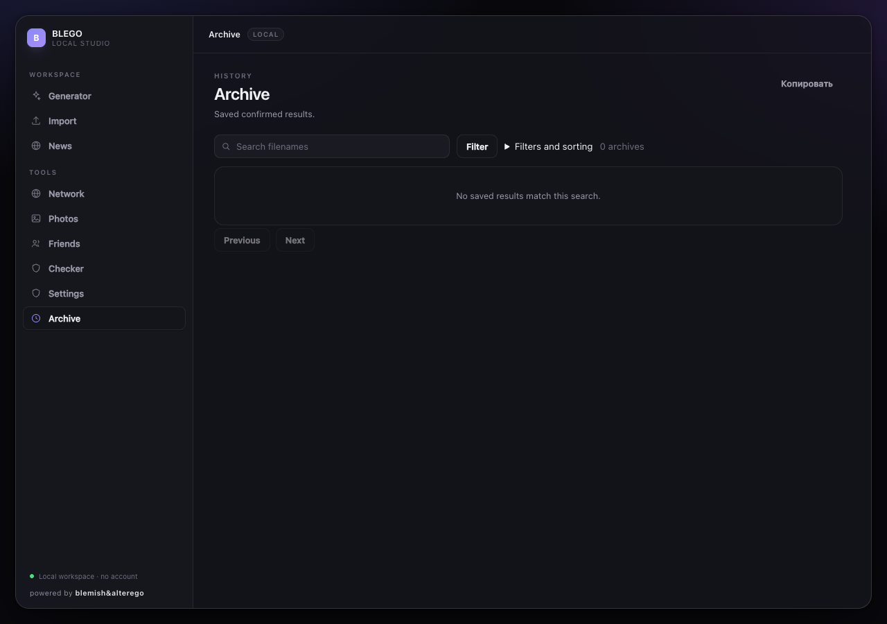 |

[Narrow original](native/ux-original-history-980.png) · [Narrow candidate](native/ux-candidate-history-980.png)

## Classifier

| Original 1280×900 | Candidate 1280×900 |
|---|---|
| 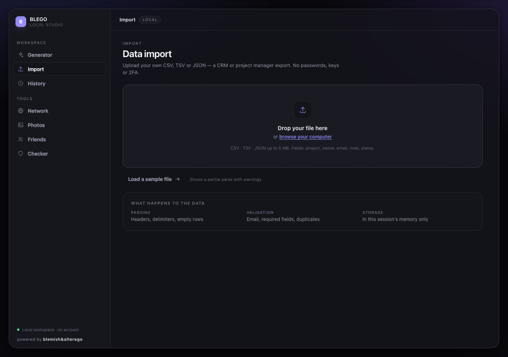 | 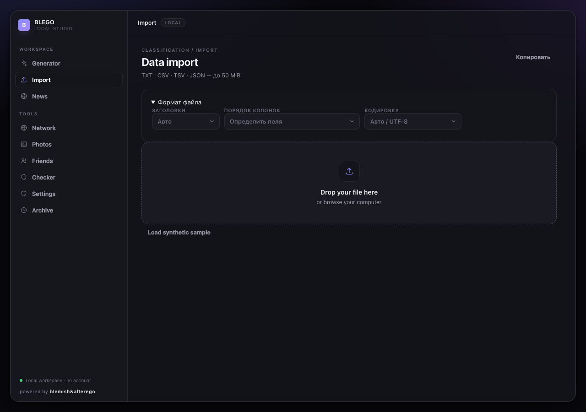 |

[Narrow original](native/ux-original-import-980.png) · [Narrow candidate](native/ux-candidate-import-980.png)

## News and working photo controls

[Standalone News](native/ux-candidate-news-1280.png) · [Narrow News](native/ux-candidate-news-980.png) · [Real five-topic News screenshots](NEWS.md)

[Date/GEO primary controls](native/photos-primary.png) · [Before/after preview](native/photos-preview.png) · [Export result](native/photos-export.png)

Static screenshots do not certify every animation or physical Mac responsiveness. Native launch/generation/frame samples and batch timing are recorded in ACCEPTANCE.md; final owner UX acceptance remains outstanding.
