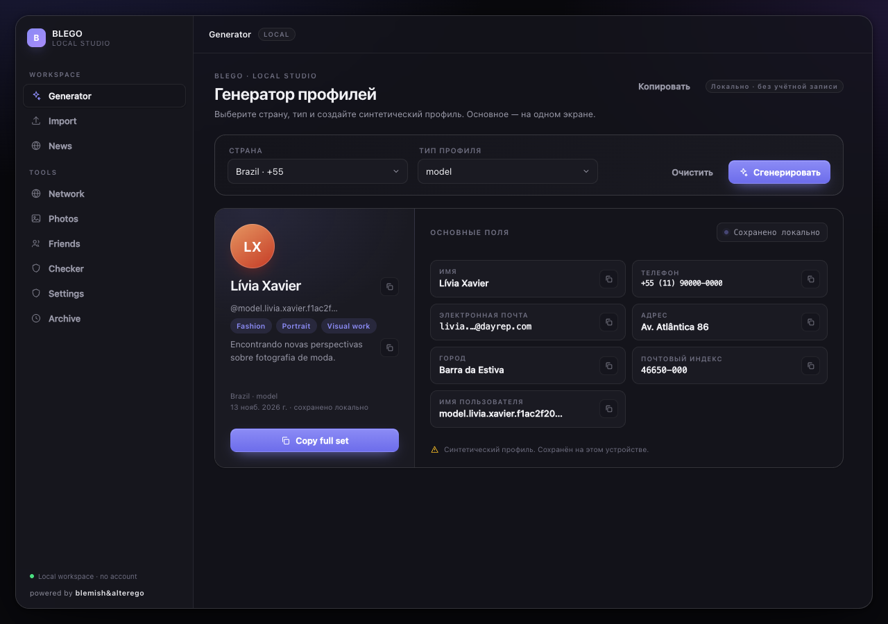

# Сравнение интерфейса BLEGO

Снимки получены в одном native workflow на macOS15.8.2 / Apple M1 Virtual: оригинал6e57eab, baseline1.3/782c1b2 и установленный кандидат9645632. Для сравнения используются одинаковые renderer viewports1280×900 и980×720; это не подмена native resize, который проверен отдельно на9ширинах. Все профили/файлы — синтетические тестовые данные.

| Раздел | Оригинал1280 | BLEGO1.3 | BLEGO1.4 |
|---|---|---|---|
| Generator | [до](native/ux-original-generator-1280.png) | [1.3](native/ux-baseline13-generator-1280.png) | [после](native/ux-candidate-generator-1280.png) |
| Network | [до](native/ux-original-network-1280.png) | [1.3](native/ux-baseline13-network-1280.png) | [после](native/ux-candidate-network-1280.png) |
| Photos | [до](native/ux-original-photos-1280.png) | [1.3](native/ux-baseline13-photos-1280.png) | [после](native/ux-candidate-photos-1280.png) |
| Archive | [до](native/ux-original-history-1280.png) | [1.3](native/ux-baseline13-history-1280.png) | [после](native/ux-candidate-history-1280.png) |
| Import | [до, пустой](native/ux-original-import-1280.png) | [1.3](native/ux-baseline13-import-1280.png) | [после, импорт1000синтетическихстрок](native/ux-candidate-import-1280.png) |
| Checker | [до](native/ux-original-checker-1280.png) | [1.3](native/ux-baseline13-checker-1280.png) | [после](native/ux-candidate-checker-1280.png) |
| News | В оригинале встроен в Generator, отдельного раздела нет | [1.3](native/ux-baseline13-news-1280.png) | [1.4](native/ux-candidate-news-1280.png) |

В native/ также сохранены соответствующие980pxснимки. Пустые News/Network здесь намеренно сняты без внешней сети для сравнимости; реальные News-проверки приведены отдельно в news-ui-live-linux.json. Пустой Archive не имитирует старые демонстрационные архивы; [настоящие тестовые записи](native/archive.png) проверяют компактные строки и копирование.

При визуальном осмотре1280pxсравнений сохранены тёмная палитра, геометрия оболочки/карточек, логотип/иконки, свечение и прибор Network. Различия функциональны: выбранная категория, независимые копии, постоянная история вместо30-минутного удаления, новый порядок адреса, правдивые статусы, Archive внизу, Photos folder/GEO/map. Это не заявление о попиксельном совпадении: подписи, элементы действий и содержимое изменены согласно ТЗ. Шесть защищённыхCSS, icons.js и исходные графические ресурсы проверены Git diff против6e57eab — изменений нет; вывод дополнен реальными снимками и GUI, не основан только на CSS.

Адаптивность установленного приложения: [360px](native/responsive-360.png), [480px](native/responsive-480.png), [980px](native/responsive-980.png), [1280px](native/responsive-1280.png), [числовой протокол9ширин×9разделов](native/responsive-native.json). Native высота ограничена рабочей областью CI; страница прокручивается вертикально.

Photos: [основной сценарий](native/photos-primary.png), [предпросмотр](native/photos-preview.png), [сохранение](native/photos-export.png), [карта до](native/v14-map-before.png), [карта после](native/v14-map-after.png). Эти снимки относятся к малым GUI-фикстурам, а не к реальным пользовательским фотографиям.

